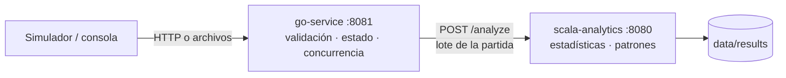

# GameStats

Plataforma para recibir, procesar y analizar los eventos que generan partidas de videojuegos. Proyecto 1 del curso de Lenguajes de Programación: el mismo problema se resuelve con dos paradigmas.

- **Go (imperativo)**: recibe los eventos por HTTP o como archivos en una carpeta, los valida contra un catálogo, reconstruye cada partida en memoria procesando muchas a la vez con goroutines y channels, y al cerrarse la envía a Scala.
- **Scala (funcional)**: transforma el lote de cada partida en estadísticas por jugador y por partida, detecta patrones que relacionan varios eventos y guarda los resultados en JSON.

Juegos incluidos: **MMA**, **fútbol**, **motociclismo** y **Free Fire** (battle royale). El formato es genérico: se puede agregar un juego nuevo editando un catálogo JSON, sin tocar el código de Go.



## Inicio rápido

Solo se necesita Docker.

```sh
bash scripts/install.sh                                      # Linux / macOS / WSL
powershell -ExecutionPolicy Bypass -File scripts\install.ps1  # Windows
```

El instalador construye y prueba los dos módulos dentro de Docker, crea las carpetas `data/inbox` y `data/results`, levanta los servicios y ejecuta una prueba de humo de punta a punta.

Luego:

```sh
docker compose run --rm simulator -scenario random -matches 10 -wait   # genera 40 partidas
```

- <http://localhost:8080/stats/games>: resumen por juego (partidas, duración, patrones, ganadores)
- <http://localhost:8080/stats/games/FREE_FIRE/players>: historial de cada jugador
- <http://localhost:8080/results>: partidas analizadas; `/results/{matchId}` para el detalle
- <http://localhost:8081/matches>: partidas recibidas por Go y estado de su análisis
- <http://localhost:8081/catalog>: formato de eventos para los productores
- <http://localhost:8081/inbox>: estado de la bandeja de archivos

Para simular una fuente que no se detiene (como será la consola de juegos): `docker compose --profile live up -d live-simulator`. Para detener todo: `docker compose down`.

La [guía paso a paso para Docker Desktop](docs/docker-local.md) explica cómo probar el PR, consultar resultados, verificar persistencia y diagnosticar errores.

## Qué cumple del enunciado

| Requisito | Dónde |
|---|---|
| Formato de eventos común y documentado | [docs/eventos.md](docs/eventos.md), catálogo en `go_service/internal/validation/event_catalog.json` |
| Juegos considerados y justificación de los eventos | [docs/juegos-y-estadisticas.md](docs/juegos-y-estadisticas.md) |
| Validación, eventos inválidos registrados o rechazados | Go: respuestas 400/409 por HTTP; `data/inbox/rejected/*.error.json` para archivos |
| Identificar juegos, partidas y jugadores; varios eventos por partida | `go_service/internal/match` |
| Concurrencia con goroutines y channels | Bandeja particionada por partida, cola de análisis con workers, simulador con una goroutine por partida |
| Estadísticas por jugador, por partida y combinando tipos de eventos | `scala_service/.../analytics/games/*` (diferencial, asistencias, K/D, cambios de líder…) |
| Reglas sobre secuencias de eventos | 9 patrones: ráfaga con knockdown, jugada colectiva, *third party*, remontadas, rachas… |
| Resultados estructurados y consultables | JSON por HTTP y en `data/results/` |
| Fuente simulada realista, partidas en paralelo | `go_service/cmd/simulator`: 8 partidas guionadas + generador aleatorio reproducible |
| Docker, ejecución integrada, CI/CD y despliegue | [docs/despliegue.md](docs/despliegue.md), `docker-compose.yml`, `.github/workflows/ci-cd.yml` |
| Justificación de la arquitectura y de los paradigmas | [docs/arquitectura.md](docs/arquitectura.md), [docs/contrato-go-scala.md](docs/contrato-go-scala.md) |

## Desarrollo local sin Docker

```sh
# Terminal 1 — Scala (Java 17 y sbt)
cd scala_service && sbt run

# Terminal 2 — Go 1.22+
cd go_service && INBOX_DIR=../data/inbox go run ./cmd/server

# Terminal 3
cd go_service && go run ./cmd/simulator -scenario all -wait
```

Pruebas: `cd go_service && go test -race ./...` y `cd scala_service && sbt test`.

Más detalle de cada módulo en [go_service/README.md](go_service/README.md) y [scala_service/README.md](scala_service/README.md).

## Estado de validación y despliegue

Las pruebas de Go y Scala y la integración con ambos procesos reales se verificaron durante la preparación de esta versión. La construcción y ejecución en Docker se valida en el trabajo `integration` del PR; revisar su resultado antes de fusionar. El trabajo `deploy` comprueba imágenes publicadas en un runner temporal de GitHub: no deja un servidor público permanente. Para la demostración local se utiliza el instalador Docker; para un servidor permanente, ver [despliegue](docs/despliegue.md).

Scala se encuentra en `scala_service/`. La configuración Scala antigua de la raíz fue sustituida por este módulo; el servidor Go continúa en `go_service/`.
