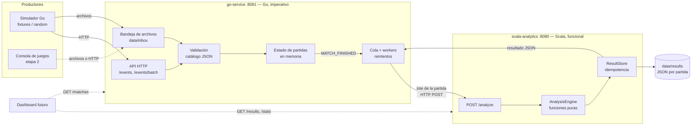

# Arquitectura

## 1. Vista general



Son dos procesos independientes, cada uno en su contenedor, que se comunican solo por HTTP con un contrato JSON documentado ([contrato-go-scala.md](contrato-go-scala.md)). Ninguno conoce la implementación del otro.

## 2. Reparto de responsabilidades y por qué

| Responsabilidad | Dónde | Por qué ese paradigma |
|---|---|---|
| Recibir eventos (HTTP y archivos), validar el sobre y los campos | Go | Es entrada/salida, manejo de errores paso a paso y estructuras que cambian con cada evento: lo natural en estilo imperativo |
| Mantener el estado de cada partida (activa o cerrada, participantes, duplicados) | Go | Estado mutable protegido con `sync.RWMutex`; cada evento lo modifica en el lugar |
| Concurrencia: muchas partidas y juegos en paralelo | Go | goroutines y channels: una goroutine por productor, workers por partición de la bandeja, cola de análisis con workers |
| Decidir cuándo una partida está lista y enviarla | Go | Control del flujo: `MATCH_FINISHED` cierra la partida, ordena sus eventos y la pone en la cola; reintentos con espera exponencial |
| Calcular estadísticas y detectar patrones | Scala | Transformar colecciones: filtrar, agrupar, reducir y componer funciones puras sin estado compartido |
| Guardar y consultar resultados, estadísticas entre partidas | Scala | El resultado es un valor inmutable y determinista; las agregaciones entre partidas son *folds* sobre resultados |

Go **no** calcula ninguna estadística: transporta el lote y guarda el resultado que devuelve Scala. Scala **no** guarda estado de partidas en curso: recibe una partida completa y la analiza aislada.

## 3. Go: flujo imperativo y concurrente

```
productor ──► handler HTTP ─┐
                            ├─► Store.Add (mutex) ──► ¿MATCH_FINISHED? ──► Service.Add ──► channel queue ──► N workers ──► cliente HTTP ──► Scala
bandeja ──► dispatcher ─────┘        valida, deduplica,                       reserva cupo                   reintenta 408/429/5xx
            (hash matchId → worker)   agrupa por matchId
```

- **Bandeja de archivos** (`internal/inbox`): un goroutine *dispatcher* recorre la carpeta en orden de nombre, decodifica cada archivo y lo separa por `matchId`. Cada partida se envía siempre al mismo worker (hash FNV del `matchId`): los eventos de una partida se aplican en orden y partidas distintas avanzan en paralelo. Los archivos terminan en `processed/` o en `rejected/` con un reporte.
- **Estado** (`internal/match`): mapa `matchId → MatchState` protegido por mutex, más el conjunto global de `eventId` para rechazar duplicados. Al cerrar la partida se crea una copia ordenada de sus eventos.
- **Cola de análisis** (`internal/processing`): un channel con capacidad limitada y `ANALYSIS_WORKERS` goroutines. Si la cola está llena, el cierre se rechaza con 503 **sin** consumir el evento, para que el productor lo reintente. Las llamadas de red ocurren fuera de los bloqueos.
- **Validación** (`internal/validation`): el catálogo de juegos es **datos** (JSON embebido o `EVENT_CATALOG_PATH`), no código. Un validador es inmutable y seguro entre goroutines.
- **Apagado controlado**: con SIGTERM primero se deja de leer la bandeja, luego se cierra HTTP y por último se vacía la cola de análisis.

## 4. Scala: núcleo funcional

```
JSON ──► JsonCodec.decodeRequest : String => Either[String, AnalysisRequest]
           (validación encadenada con for / flatMap, traverse con foldRight)
     ──► AnalysisEngine.analyze  : AnalysisRequest => AnalysisResult          (pura y determinista)
           ├─ GenericAnalytics          (cualquier juego)
           └─ GameAnalyzer del gameId   (MMA, FOOTBALL, MOTORCYCLE_RACING, FREE_FIRE)
                 playerStats / matchStats / patterns / inferredWinner : MatchContext => …
     ──► ResultStore.register   (AtomicReference[Map] inmutable; idempotencia)
     ──► Api.handle : HttpRequest => HttpResponse
```

- **Inmutabilidad**: los eventos, el contexto de partida y los resultados son `case class` inmutables. No hay `var` en el análisis; las colecciones se transforman en otras nuevas.
- **Operaciones funcionales con propósito**: `groupMapReduce` para conteos y sumas por jugador, `foldLeft` para el marcador y las métricas entre partidas, `scanLeft` para diferenciales y marcadores acumulados (remontadas), `tails` y `takeWhile` para ventanas deslizantes (rachas, cadenas de pases), `collect` y `flatMap` con `Option` para leer campos opcionales sin `null`, comprensiones `for` para encadenar validaciones con `Either`.
- **Composición**: `AnalysisEngine` compone las estadísticas genéricas con las del analizador del juego. Agregar un juego es agregar otro valor al mapa `analyzers`.
- **Errores como valores**: un lote inválido produce `Left(mensaje)` y la API responde 400. No se usan excepciones para el control del flujo.
- **Borde imperativo pequeño**: solo `Main.scala` (servidor `com.sun.net.httpserver` con un pool de hilos) y la escritura de archivos en `ResultStore` producen efectos. `Api.handle` es una función que se prueba sin abrir puertos.
- **Concurrencia sin bloqueos explícitos**: varios hilos atienden peticiones a la vez. Comparten solo un `AtomicReference` con un `Map` inmutable que se reemplaza de forma atómica (`getAndUpdate`).

## 5. Comunicación entre módulos

Elegimos **HTTP/REST síncrono con JSON**: Go hace `POST /analyze` con el lote de la partida y Scala responde 200 con el resultado completo.

- Es fácil de inspeccionar (curl, navegador), de probar y de documentar, y sirve igual para el dashboard futuro.
- **Idempotencia**: Go envía `Idempotency-Key` (SHA-256 del cuerpo). Scala guarda el hash de cada partida analizada: el mismo lote devuelve el mismo resultado sin recalcular (`Idempotent-Replay: true`), y un lote distinto para un `matchId` ya analizado se rechaza con 409.
- **Reintentos**: Go reintenta los fallos de red, los timeouts y los HTTP 408/429/5xx con espera exponencial. Si se agotan los intentos, el lote queda `FAILED` y se puede reintentar con `POST /matches/{id}/analysis/retry`.
- **Alternativas consideradas**: archivos compartidos (más simple, pero sin respuesta inmediata ni control de errores por partida) y un broker de mensajes (más robusto, pero agrega otro servicio que instalar y mantener). Para el alcance del curso, HTTP equilibra simplicidad y control. La bandeja de archivos sí se usa para la **entrada**, porque así trabajará la consola de juegos.

## 6. Persistencia

- Go mantiene las partidas y su estado de análisis **en memoria**: es un buffer de ingestión, no el registro histórico.
- Scala guarda cada resultado en `data/results/<matchId>.json` (escritura atómica con archivo temporal y renombrado) y los vuelve a cargar al iniciar. Ese es el historial que consultará el dashboard. Un fallo de disco no invalida el análisis: el resultado sigue disponible en memoria y el error queda en el log.

## 7. Ventajas y limitaciones observadas de cada enfoque

| | Imperativo (Go) | Funcional (Scala) |
|---|---|---|
| Ventajas | Control explícito del orden, de los bloqueos y de los recursos; la concurrencia con goroutines y channels es directa; buen rendimiento con poca memoria | Cada estadística es una expresión corta y verificable; sin estado compartido no hay condiciones de carrera en el análisis; el resultado determinista hace trivial la idempotencia; probar es llamar una función |
| Limitaciones | Más código para lo mismo (bucles, mapas auxiliares); el estado mutable obliga a disciplina con mutex y copias defensivas | Los efectos (red, disco) quedan en un borde que sigue siendo imperativo; algunas reglas con ventanas de tiempo son menos obvias de leer; la JVM tarda más en arrancar y usa más memoria |

## 8. Estructura del repositorio

```
.
├── go_service/                 Módulo Go (ingestión)
│   ├── cmd/server              Servidor HTTP + bandeja
│   ├── cmd/simulator           Fuente de eventos simulada
│   └── internal/
│       ├── domain              Sobre de eventos, lotes y resultados
│       ├── validation          Catálogo de eventos (JSON) y validador
│       ├── match               Estado de partidas
│       ├── processing          Cola, workers y reintentos hacia Scala
│       ├── inbox               Ingestión concurrente de archivos
│       ├── scala               Cliente HTTP del contrato
│       ├── simulation          Partidas guionadas, aleatorias y productores
│       └── transport/http      Rutas y respuestas
├── scala_service/              Módulo Scala (análisis)
│   └── src/main/scala/gamestats/
│       ├── model               Eventos, contexto de partida, resultados
│       ├── json                Decodificación y lectura de resultados
│       ├── analytics           Motor, estadísticas genéricas y entre partidas
│       │   └── games           Un analizador por juego
│       └── server              API, almacén de resultados
├── docs/                       Documentación
├── scripts/                    Instalación y prueba de humo
├── docker-compose.yml          Construcción desde el código
├── docker-compose.release.yml  Despliegue con imágenes publicadas
└── .github/workflows/ci-cd.yml Pipeline CI/CD
```
