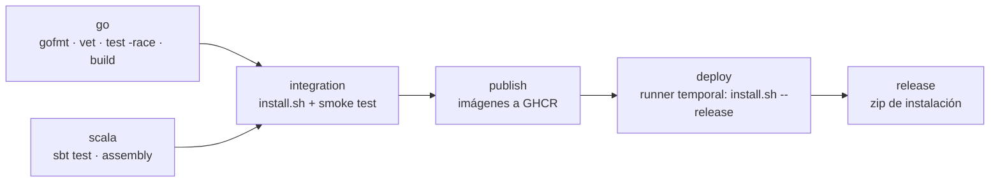

# Instalación, ejecución y despliegue

## 1. Requisitos

Solo **Docker** con Docker Compose v2 (Docker Desktop en Windows y macOS, Docker Engine en Linux). No hace falta instalar Go, Scala, Java ni sbt: todo se compila dentro de las imágenes.

## 2. Instalación en una máquina nueva

```sh
git clone https://github.com/Brxck2203/LenguajesProject1.git
cd LenguajesProject1
bash scripts/install.sh                                      # Linux, macOS o WSL
powershell -ExecutionPolicy Bypass -File scripts\install.ps1  # Windows
```

El script:

1. Verifica que Docker esté instalado y corriendo.
2. Crea `data/inbox` (con `processed/` y `rejected/`) y `data/results`, con permisos de escritura para los usuarios sin privilegios de los contenedores.
3. Construye las imágenes (compila **y prueba** Go y Scala dentro de Docker) y levanta los servicios esperando a que estén sanos (`docker compose up -d --build --wait`).
4. Ejecuta la **prueba de humo** (`scripts/smoke-test.sh`): envía partidas por HTTP y por archivos, espera los análisis y comprueba las estadísticas y los patrones de los cuatro juegos.

La primera construcción tarda varios minutos porque descarga las dependencias de sbt; las siguientes usan la caché de Docker.

**Con imágenes ya publicadas** (sin compilar): `bash scripts/install.sh --release` o `install.ps1 -Release`. Usa `docker-compose.release.yml` y descarga las imágenes que publicó el pipeline en GitHub Container Registry. El paquete `gamestats-vX.Y.Z.zip` de cada Release contiene solo eso: el archivo compose, los scripts y la documentación.

## 3. Uso

| Acción | Comando |
|---|---|
| Levantar | `docker compose up -d --build --wait` |
| Partidas guionadas (8) por HTTP | `docker compose run --rm simulator` |
| Partidas aleatorias esperando a Scala | `docker compose run --rm simulator -scenario random -matches 10 -wait` |
| Partidas como archivos en la bandeja | `docker compose run --rm simulator -mode files -scenario random -matches 5` |
| Fuente continua (como la consola) | `docker compose --profile live up -d live-simulator` |
| Ver registros | `docker compose logs -f go-service scala-analytics` |
| Detener | `docker compose down` (los datos de `data/` se conservan) |

Opciones del simulador: `-scenario fixtures|random|all`, `-matches N` (partidas aleatorias por juego), `-seed N` (repite exactamente las mismas partidas), `-mode http|files`, `-chunk N` (eventos por archivo), `-interval` (pausa entre eventos o archivos), `-continuous -every 20s`, `-wait`, `-prefix` (identificadores reconocibles), `-timeout` (0 = sin límite).

Use un `-prefix` nuevo en cada ejecución (el valor por defecto ya es único). Scala conserva los resultados en disco: si reenvía una partida con el mismo `matchId` pero eventos distintos, la rechaza como conflicto en vez de sobrescribirla.

### Consultas

Go (`http://localhost:8081`):

| Ruta | Contenido |
|---|---|
| `GET /` | Índice y juegos soportados |
| `GET /catalog` | Catálogo de eventos (formato para productores) |
| `GET /inbox` | Estado de la bandeja: archivos procesados, rechazados y último error |
| `GET /matches` | Partidas recibidas |
| `GET /matches/{id}` | Resumen: juego, participantes, eventos y estado |
| `GET /matches/{id}/analysis` | Estado del análisis y resultado |
| `POST /matches/{id}/analysis/retry` | Reintento manual de un análisis `FAILED` |

Scala (`http://localhost:8080`):

| Ruta | Contenido |
|---|---|
| `GET /results` | Partidas analizadas con ganador y patrones |
| `GET /results/{id}` | Resultado completo |
| `GET /stats/games` | Resumen por juego |
| `GET /stats/games/{gameId}/players` | Historial de cada jugador |

En PowerShell: `Invoke-RestMethod http://localhost:8080/stats/games | ConvertTo-Json -Depth 10`.

## 4. Servicios, carpetas y variables

| Servicio | Imagen | Puerto | Carpeta montada |
|---|---|---|---|
| `scala-analytics` | `eclipse-temurin:17-jre` con el jar ensamblado | 8080 | `./data/results` → `/data/results` |
| `go-service` | `alpine` con el binario estático | 8081 | `./data/inbox` → `/data/inbox` |
| `simulator` (perfil `demo`) | misma imagen de Go | — | `./data/inbox` |
| `live-simulator` (perfil `live`) | misma imagen de Go | — | `./data/inbox` |

Go arranca solo cuando Scala está sano (`depends_on: condition: service_healthy`). Las dos imágenes corren con usuarios sin privilegios.

Variables de Compose (archivo `.env` opcional, ver `.env.example`): `GO_PORT`, `SCALA_PORT`, `SKIP_TESTS`, `IMAGE_REGISTRY`, `GAMESTATS_TAG`.

Variables de Go: `PORT`, `SCALA_ANALYSIS_URL`, `SCALA_TIMEOUT`, `ANALYSIS_WORKERS`, `ANALYSIS_CAPACITY`, `ANALYSIS_MAX_ATTEMPTS`, `ANALYSIS_RETRY_BASE`, `ANALYSIS_RETRY_MAX`, `SHUTDOWN_TIMEOUT`, `EVENT_CATALOG_PATH`, `INBOX_DIR`, `INBOX_POLL_INTERVAL`, `INBOX_WORKERS`. Variables de Scala: `PORT`, `RESULTS_DIR`, `HTTP_THREADS`.

## 5. Pipeline CI/CD (`.github/workflows/ci-cd.yml`)



| Etapa | Cuándo | Qué hace |
|---|---|---|
| `go` | siempre | Verifica formato, `go vet`, pruebas con detector de carreras; guarda los binarios como artefacto |
| `scala` | siempre | `sbt test assembly`; guarda el jar como artefacto |
| `integration` | siempre | Instalación desde cero con `scripts/install.sh` en una máquina limpia de GitHub (construye las imágenes, crea las carpetas, levanta y ejecuta la prueba de humo). Guarda `data/results` y los registros |
| `publish` | push a `main` o tag `v*` | Publica `scala-analytics` y `go-service` en `ghcr.io/<usuario>/<repo>` con etiquetas `latest`, `sha-xxxxxxx` y la versión del tag |
| `deploy` | después de `publish` | Instala la versión publicada en un runner temporal y la verifica con `install.sh --release`; no deja un servicio público permanente |
| `release` | tag `v*` | Crea el Release de GitHub con `gamestats-vX.Y.Z.zip` |

Publicar una versión:

```sh
git tag v1.0.0
git push origin v1.0.0
```

**Entorno de verificación.** Por defecto, `release-verification` es un runner temporal de GitHub: la versión publicada se instala desde el registro y se prueba, igual que lo haría el profesor. Para desplegar en una máquina propia (un servidor, una VM o la computadora del equipo), registre ahí un *self-hosted runner* (Settings → Actions → Runners) con Docker instalado y cambie `runs-on: ubuntu-latest` por `runs-on: self-hosted` en el trabajo `deploy`. Los servicios quedan corriendo en esa máquina. El runner hospedado predeterminado se destruye al terminar el trabajo; no constituye un servidor permanente. La demostración local usa el instalador en la computadora del equipo como entorno definido de ejecución.

**Visibilidad de las imágenes.** GitHub crea los paquetes como privados. Para que cualquiera pueda usar `install.sh --release` sin iniciar sesión, en GitHub → Packages → cada paquete → *Package settings* → *Change visibility* → *Public*. Si quedan privados: `docker login ghcr.io` con un token con permiso `read:packages`.

## 6. Verificación en una máquina limpia (checklist antes de entregar)

1. Clonar el repositorio en una computadora que solo tenga Docker.
2. Ejecutar `bash scripts/install.sh` (o `install.ps1`) y esperar el mensaje `OK: Go y Scala integrados`.
3. Abrir `http://localhost:8080/stats/games` y `http://localhost:8081/matches`.
4. Copiar un archivo de eventos a `data/inbox/` y comprobar que pasa a `processed/` y que su análisis aparece en `data/results/`.
5. `docker compose down` y `docker compose up -d --wait`: los resultados de Scala siguen disponibles.

## 7. Problemas comunes

| Síntoma | Causa y solución |
|---|---|
| `bind: address already in use` | El puerto 8080 u 8081 está ocupado: cambie `SCALA_PORT`/`GO_PORT` en `.env` |
| `GET /inbox` muestra `enabled: false` con un error de permisos | En Linux, `data/inbox` no admite escritura: `chmod -R a+rwX data` (el instalador lo hace) |
| Un análisis queda `FAILED` con HTTP 409 | Se reenvió un `matchId` existente con eventos distintos: use otro `-prefix` |
| Archivos en `data/inbox/rejected/` | Ver `<archivo>.error.json`: indica el evento y el motivo |
| La primera construcción de Scala es lenta | Descarga de dependencias de sbt; las siguientes usan caché. `SKIP_TESTS=true` omite las pruebas dentro de la imagen |

## 8. Guías de uso

- [Prueba paso a paso con Docker Desktop](docker-local.md).
- [Instrucciones del paquete Release](release-readme.md): utiliza siempre `--release` / `-Release` y `docker compose -f docker-compose.release.yml`.

El reinicio de Go pierde sus partidas y análisis en memoria; los resultados persistidos por Scala continúan disponibles en `/results`. No se requiere eliminar `data` entre pruebas.
